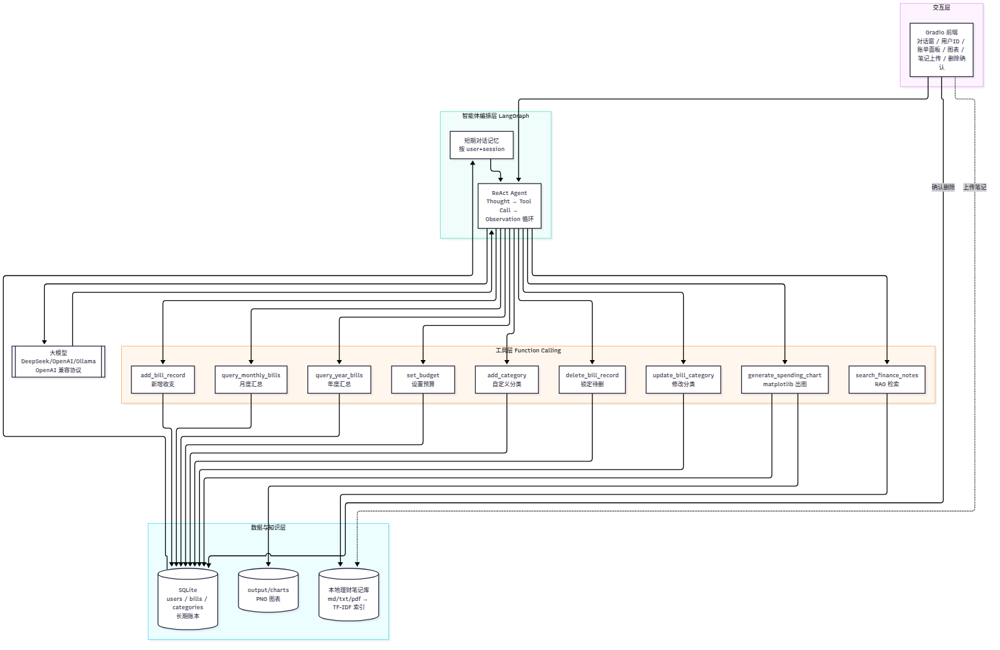
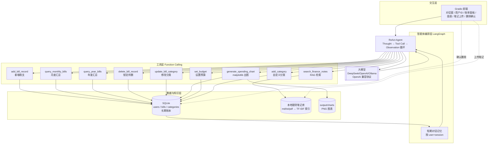
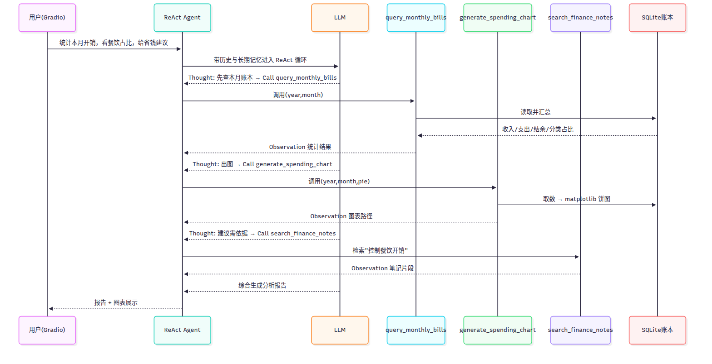
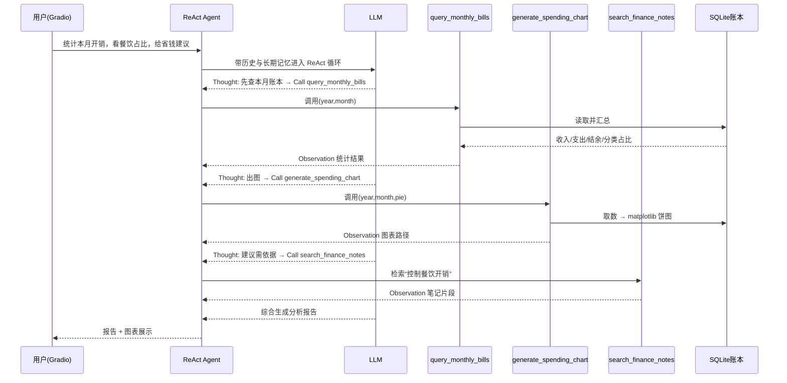

# 本地个人财务记账智能体 · 设计文档

课程：人工智能综合实践（AITN004_20P）　考试方式：大作业
技术栈：Python 3.12 / LangChain / LangGraph（ReAct）/ SQLite / scikit-learn(TF-IDF) / matplotlib / Gradio

---

## 一、选题背景与需求分析

### 1.1 选题背景
大学生每月生活费有限，普遍存在“记账坚持不下来、月底不知道钱花在哪、开销结构失衡、缺乏理财方法”的问题。
市面记账 App 多为固定表单录入，缺少自然语言交互与自动分析能力；本项目做一个**本地、隐私、可离线运行**的
个人财务记账智能体：用户用口语化指令完成记账与分析，智能体自主调用工具、检索本地理财知识并给出建议。

### 1.2 目标用户
- 主力用户：每月领取生活费、需要控制餐饮/娱乐支出的在校学生；
- 次要用户：有兼职收入、希望做月度预算复盘的年轻上班族。

### 1.3 核心需求
| 需求 | 对应实现 |
|------|----------|
| 说一句话就能记账，不用填表单 | 工具 `add_bill_record` + ReAct 抽取金额/分类/日期 |
| 随时知道本月花了多少、花在哪 | 工具 `query_monthly_bills` 汇总 + 分类占比 |
| 直观看到开销结构 | 工具 `generate_spending_chart` 饼图/柱状图 |
| 建议要有依据，不是空泛说教 | RAG 检索本地理财笔记 `search_finance_notes` |
| 记得住我、不串别人的账 | SQLite 长期账本 + 多用户隔离 + 短期对话记忆 |
| 分类能按需扩展 | `add_category` / `update_bill_category` 自定义分类（按用户隔离） |
| 删错能反悔 | `delete_bill_record` 锁定 → 界面确认后才真正删除（带 user_id 校验） |
| 本地可用、数据不上云 | 全部本地存储，仅大模型推理走 API |

### 1.4 非目标
不做多人共享账本、不接支付平台流水、不做投资交易；聚焦“记录—统计—可视化—建议”闭环。

---

## 二、系统架构设计

### 2.1 整体架构图（分层）



*（上图为 PNG 渲染版；以下 mermaid 源码保留，便于后续修改后重新导出）*



### 2.2 核心调度流程（以“统计本月开销、看餐饮占比、给省钱建议”为例）



*（上图为 PNG 渲染版；以下 mermaid 源码保留，便于后续修改后重新导出）*



### 2.3 调度逻辑与关联说明
- **编排**：`langgraph.prebuilt.create_react_agent` 内置 ReAct 循环，模型自主决定调用哪个工具、调用几次、何时结束；
- **工具调用链路**：工具以 LangChain `@tool` 注册，由模型按 Function Calling 协议传参；用户身份通过 contextvars
  在调用前注入，避免模型猜测 user_id；
- **记忆机制**：短期记忆（`memory.ShortTermMemory`，deque 限长）保留本轮上下文；长期记忆落 SQLite
  （历史账单永久保存 + users 表偏好 + categories 自定义分类），每轮把偏好与最近 3 条账注入系统提示词；
- **RAG 机制**：笔记加载→段落切分→TF-IDF(char n-gram) 索引→余弦相似度取 top-k，作为工具返回给模型；
- **产物回流**：图表路径写入请求级 artifacts，智能体返回后由 Gradio 读取并渲染；待删除账单写入
  进程内 `_pending_delete` 状态，用户点击【确认删除】后才真正落库删除。

---

## 三、技术实现细节

### 3.1 智能体编排（agent.py）
- `create_react_agent(model=ChatOpenAI(...), tools=TOOLS, prompt=SYSTEM_PROMPT)`，`TOOLS` 共绑定 **9 个**自定义工具；
- 每轮组装消息：`[系统消息(基础提示词+当前时间+长期记忆), ...短期历史, 用户消息]`；
- `ChatOpenAI` 走 OpenAI 兼容协议，DeepSeek/OpenAI/Ollama 仅改 `.env` 三行即可切换；
- 模型不可用时（未配密钥）抛出明确错误，由前端捕获并友好提示，不崩溃。

### 3.2 工具定义与注册（tools.py）
| 工具 | 入参 | 作用 | 数据落点 |
|------|------|------|----------|
| `add_bill_record` | bill_type, amount, category, note, date, user_specified_category | 写一条收支（用户指定的自定义分类自动创建） | SQLite bills |
| `query_monthly_bills` | year, month, bill_type, category | 月度汇总并返回文本统计 | 读 SQLite |
| `query_year_bills` | year, bill_type, category | 年度汇总：全年收支/占比/按月分布 | 读 SQLite |
| `generate_spending_chart` | year, month, chart_type | 生成饼图/柱状图 | output/charts |
| `search_finance_notes` | query | RAG 检索理财笔记 | 笔记库 |
| `set_budget` | monthly_budget | 设置用户月预算 | users 表 |
| `add_category` | bill_type, category | 添加自定义分类（按用户隔离） | categories 表 |
| `delete_bill_record` | bill_id | 锁定待删账单（界面确认后才真正删除，带 user_id 校验） | SQLite bills |
| `update_bill_category` | bill_id, category, user_specified_category | 修改账单分类（支持自动创建自定义分类） | SQLite bills |

工具描述（docstring）即 Function Calling 的参数说明，模型据此抽参；金额/日期做校验，失败返回可读错误。

### 3.3 提示词工程（完整版见 5.3）
明确“数字必须来自工具、禁止编造”，规定工具使用时机、分类词表、报告三段式结构（收支结余→分类占比→
可执行建议），并新增三条关键规则：**记账分类规则**（用户明确说出的分类原样创建，未说明则由模型推断并
归入“其他”）、**账单定位规则**（多条匹配时先列候选让用户确认，不擅自操作）与**综合全部笔记规则**
（检索返回的多条笔记片段必须全部纳入考虑并综合引用，逐条注明来源，不得只取一条）；同时把当前年月、
用户长期画像注入系统消息，减少模型歧义

### 3.4 RAG 设计（rag_store.py）
- 加载：`.md/.txt` 直读，`.pdf` 用 pypdf 抽取；
- 切分：按段落/句子切到约 300 字，保留 40 字重叠，避免语义截断；
- 检索：`TfidfVectorizer(analyzer="char_wb", ngram_range=(1,2))` 对中文友好、零外部模型，
  余弦相似度取 top-3，低于阈值 0.05 视为无命中；
- 可扩展：接口独立，可替换为 FAISS + Embedding。

### 3.5 记忆与数据设计（db.py / memory.py）
- 表结构：
  - `users(user_id PK, nickname, monthly_budget, preferences JSON, created_at)`；
  - `bills(id, user_id, bill_type, amount, category, note, bill_date, created_at)`；
  - `categories(id, bill_type, category, created_by, created_at, UNIQUE(bill_type, category, created_by))`
    实现**多用户自定义分类隔离**，预设分类与用户自定义分类合并去重后供记账使用。
- 多用户隔离：所有查询/删除/修改都带 `user_id`，越权操作返回 None 并拒绝；
- 短期记忆 deque 限 10 轮，防止上下文膨胀；长期偏好（月预算等）每轮召回，最近 3 条账目注入提示词。

### 3.6 前端（ui.py）
左侧对话 + 用户ID；右侧月预算面板、最近三天账单表格、统计图、笔记上传、待删除账单确认区；事件绑定
提交/清空/切换用户/更新预算/上传/确认删除。

---

## 四、测试结果与分析

### 4.1 离线自动化测试（`tests/test_core.py`，无需密钥）
运行 `python tests/test_core.py`，结果：

| 用例 | 预期 | 结果 |
|------|------|------|
| 建库/记账/月度汇总 | 支出110.4、收入1500、结余1389.6、餐饮占比正确 | PASS |
| 多用户隔离 | alice/bob 账单互不串 | PASS |
| RAG 检索 | “50/30/20”“餐饮外卖奶茶”均命中 | PASS（59 片段索引） |
| 图表生成 | 饼图/柱状图文件非空 | PASS |
| 四工具串行调用 | 记账→查询→出图(2张)→检索成功 | PASS |
| 删除闭环 | 锁定/回传/确认删除/越权防护 | PASS |
| 分类管理 | 非法类型报错/自定义分类创建/未指定归其他/手动添加/用户隔离 | PASS |
| 修改账单分类 | 预设/自定义/自动创建/越权防护/不存在 | PASS |

### 4.2 典型对话 Case（接大模型后）

**Case 1 记账**
- 输入：“记一笔，今天中午食堂吃饭花了18块，餐饮”
- 工具：`add_bill_record(expense,18,餐饮,食堂午餐,今天)`
- 输出：“记账成功：已记录 … 支出 餐饮 18 元。”

**Case 2 多步分析（核心）**
- 输入：“帮我统计本月开销，看看餐饮占比，同时给我下个月省钱建议”
- 工具链：`query_monthly_bills` → `generate_spending_chart(pie)` → `search_finance_notes`
- 输出：本月收入/支出/结余、餐饮占比与饼图、结合笔记的 2-3 条建议（食堂优先、设每日餐饮上限等）。

**Case 3 收入与跨月**
- 输入：“上周末兼职赚了300，记成收入”“看看9月花了多少”
- 工具：`add_bill_record(income,300,兼职)`；`query_monthly_bills(上月)`。

**Case 4 删除与改分类**
- 输入：“把刚才那笔记错的餐饮改成交通”“删掉今天中午那笔”
- 工具：`query_monthly_bills` 定位 → `update_bill_category` / `delete_bill_record`（锁定 → 界面确认删除）。

### 4.3 存在问题与优化方向
1. TF-IDF 语义召回有限，同义词弱 → 可换 FAISS + 向量 Embedding / rerank；
2. 日期/金额抽取依赖模型，复杂口语可能需追问 → 可加参数校验节点与澄清反问；
3. 图表为静态 PNG → 可升级 Plotly 交互图；
4. 短期记忆在内存，重启丢失 → 可接入 SQLite/Redis 持久化与 LangGraph checkpointer；
5. 可增加预算超支主动提醒、周报自动生成。

---

## 五、补充材料

### 5.1 自定义工具清单（完整代码见 `finagent/tools.py`）
`add_bill_record`、`query_monthly_bills`、`query_year_bills`、`generate_spending_chart`、
`search_finance_notes`、`set_budget`、`add_category`、`delete_bill_record`、`update_bill_category`，
共 9 个，均用 `@tool` 装饰，docstring 作为函数说明，统一通过 contextvars 取当前 user_id。

### 5.2 模型选型依据
- **首选 DeepSeek-chat**：中文好、函数调用稳定、价格低，适合学生预算；
- 兼容 OpenAI 协议，可无缝换 gpt-4o-mini 或本地 Ollama(qwen2.5)，避免绑定单一厂商；
- temperature=0.3，保证记账数字稳定、减少自由发挥。

### 5.3 系统提示词完整版（agent.py SYSTEM_PROMPT）

```
你是「本地个人财务记账智能体」，面向大学生做日常收支记账与消费分析。
你不是通用闲聊机器人，所有账目数字都必须来自工具读取的本地账本，禁止凭空编造金额。

【可用工具与使用时机】
1. add_bill_record：用户说"记一笔/花了/收入"时调用，写入一条收支；金额、分类、日期要问清或按对话推断。分类处理遵循下方【记账分类规则】。
2. query_monthly_bills：用户要"查账/统计/看看某月开销/结余/某分类占比"时调用，先取数再回答。
3. generate_spending_chart：用户要看图、占比饼图、每日趋势时调用；分析月度开销时主动出图。
4. search_finance_notes：给省钱建议、预算方法、理财规则前调用，结合检索到的本地笔记作答，并注明依据；当检索返回多条笔记片段时，必须综合使用全部片段作答，不得只引用其中一条或忽略其余。
5. set_budget：用户说"我月预算XXX/这个月预算XXX/设置预算"时调用，更新当前用户的月预算金额。
6. query_year_bills：用户要"这一年/全年/某一年总开销、年度汇总、全年结余"时调用，返回全年收支、分类占比与按月分布。
7. delete_bill_record：用户要"删除/撤销/删掉某笔账单"时调用；该工具只"锁定"待删除账单并返回详情，不会真正删除，真正删除需用户在界面点击【确认删除】。调用后应把待删除详情转告用户，并提示其点击【确认删除】按钮。
8. add_category：用户要"新增/添加一个分类"（如"添加分类：宠物"）时调用，把自定义分类加入分类列表。
9. update_bill_category：用户要"修改/更改某笔账单的分类"时调用；先用 query_monthly_bills 列出明细拿到账本ID，再传入 bill_id 与新分类。

【工作规则】
- 先想清楚再调用工具（Thought）：判断该记账、查账、绘图还是查笔记；一步拿不到结论就分步串行调用。
- 用户说"本月/这个月"而未给年月时，使用系统提供的当前年月；说"上月"则减一个月。
- 支出分类：餐饮/交通/购物/娱乐/学习/住宿/医疗/通讯/其他；收入分类：生活费/奖学金/兼职/红包/退款/其他。
- 【记账分类规则】用户明确说出的分类，add_bill_record 的 user_specified_category 传 True 并原样传该分类（系统会自动创建不在列表中的新分类）；用户未说明分类时由你推断，user_specified_category 传 False，推断的分类若不在列表，系统会自动归入"其他"。
- 分析报告结构：①本月收入/支出/结余；②支出分类占比（点名最大项）；③结合检索到的全部笔记片段，综合给出 2-3 条可执行的省钱建议，并逐条注明依据来源。
- 综合全部笔记：search_finance_notes 返回的每条笔记片段都是有效依据，作答时必须全部纳入考虑并综合引用，禁止只选取相关度最高的一条而丢弃其余；每条建议都应标注其来自哪篇笔记。
- 数字一律以工具返回为准；账本为空时如实说明，并引导先记账。
- 删除账单不可逆：先 query_monthly_bills 列出明细与账本ID，再用 delete_bill_record 锁定要删的那一笔（该工具不真正删除，只是登记待删），把详情展示给用户并提示其在界面点击【确认删除】。
- 修改账单分类：先 query_monthly_bills 列出明细定位账本ID，再用 update_bill_category 修改；用户明确说出的新分类会自动创建。
- 定位账单时若用户描述匹配到多条（如同一天多笔同分类的账单），不要擅自选一条，先用 query_monthly_bills 把候选（日期/分类/金额/备注）列给用户，请用户确认是哪一笔后再操作。
- 账单的 ID 是系统内部标识，仅用于定位要删除/修改的记录；向用户回复时不要输出 ID 数字。
- 语气简洁、口语化，适合学生；不要输出工具内部字段。
```

### 5.4 依赖说明
见 `requirements.txt`：langchain / langgraph / langchain-openai / openai / gradio /
pandas / scikit-learn / matplotlib / pypdf / pdfplumber / python-dotenv。
